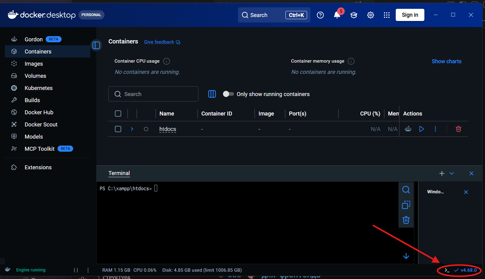

# 🏠 Domiki

# Подключение 
## к репозиторию
```bash
cd C:\xampp\htdocs

git init
git branch -M main
git remote add origin https://github.com/Temrjdzza/domiki.git
```

## К докеру
Переходим в докер и нажимаем на консоль.


Вводим команды
```bash
cd C:\xampp\htdocs

docker-compose up -d --build
docker-compose up 
```

---
# 📁 Структура проекта
- Frontend — по пути src/resources
- Backend — большая часть в src

## Задачи на данный момент
### 🎨 Для фронтенда
- [ ] Доделать страницу выбора квартир для ЖК
- [ ] Сделать адаптивность для устройств
- [ ] Подогнать цветовую гамму как из исходноков

Исходники - [тут](./docs/README.md)

### ⚙️ Для бэкенда
🚧 Информация отсутствует
